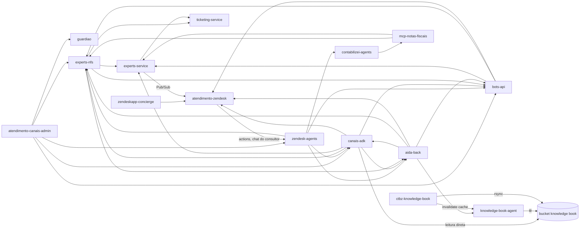

# Grafo de chamadas: Canais / Experts / AIDA

Mapa manual (não é gerado pela skill `atualizar-catalogo-gcp`) de quais repositórios chamam quais, para saber o impacto de mudar um contrato e por onde uma requisição passa. Fonte: o contexto global que um colega do time publicou no [Marketplace de IA](https://admin.ctbz.com.br/api/atendimento-canais/marketplace/A8ZV3J2IqTC4e4eowPKS) do `atendimento-canais-admin`. Antes de confiar numa aresta para revisar um MR, conferir no código do consumidor (ver [[consumidores-entre-repositorios]]).

## Papel e stack

| Repo | Papel | Stack |
| --- | --- | --- |
| `atendimento-canais-admin` | Backoffice admin dos canais | React 19, TanStack Start, shadcn, ds-tokens |
| `aida-front` / `aida-back` | Assistente de IA do atendimento (AIDA) | React / Python Flask |
| `zendesk-agents` | Ponte Zendesk ↔ agentes de IA | Fastify, zezu |
| `canais-adk` | Agent Dev Kit dos canais (sessions, agents v2, MCP) | Fastify, zezu |
| `bots-api` | Bots e flags dos canais | Fastify, zezu |
| `experts-nfs` | Emissão de notas fiscais (expõe MCP) | Fastify |
| `experts-service` | Core Experts | Fastify (Bun) |
| `ticketing-service` | Tickets/cards | Fastify |
| `contabilizei-agents` / `mcp-notas-fiscais` | Agentes de IA / servidor MCP | Python (uv) |
| `knowledge-book-agent` | Agente da base de conhecimento (search + editor), Cloud Run | Python 3.14 (uv), FastAPI, litellm |
| `ctbz-knowledge-book` | Conteúdo da KB em markdown + scripts de conversão/sync (grupo `ia/geral`) | Python, google-genai |
| `atendimento-zendesk` | Hub de integração com o Zendesk e BFF dos apps Zendesk; dependência de quase todos | NestJS |
| `zendeskapp-concierge` / `-timeline` / `-whatsapp-ativo` | Apps ZAF v2 dentro do Zendesk | React |
| `experts-admin`, `tarefas-assessor-admin`, `contabilizei-front-vue` | Admin Experts, tarefas do assessor, plataforma do cliente | Vue |
| `guardiao` | Auth de sistemas internos | Deno |

## Quem chama quem (A → B = A consome B)

Em texto, para busca:

- `atendimento-canais-admin` → `guardiao`, `experts-nfs`, `zendesk-agents`, `canais-adk`, `bots-api`
- `zendeskapp-concierge` → `atendimento-zendesk` (BFF) → `zendesk-agents` (actions, chat do consultor)
- `zendesk-agents` → `canais-adk`, `aida-back`, `bots-api`, `experts-nfs`, `contabilizei-agents`
- `canais-adk` → `aida-back`, `experts-nfs`, `experts-service`, `bots-api`, `atendimento-zendesk`, bucket do knowledge book (leitura direta)
- `bots-api` → `experts-service`, `experts-nfs`, `atendimento-zendesk`
- `experts-nfs` → `experts-service`, `ticketing-service`, `bots-api`, `aida-back`
- `experts-service` → `atendimento-zendesk` (Pub/Sub), `ticketing-service`
- `aida-back` → `bots-api`, `canais-adk`, `experts-nfs`, `atendimento-zendesk`, `knowledge-book-agent`
- `contabilizei-agents` → `mcp-notas-fiscais` → `experts-nfs`, `experts-service`

Leituras úteis do grafo: `atendimento-zendesk`, `bots-api`, `experts-nfs` e `aida-back` são os mais consumidos (mudança de contrato neles tem raio de impacto grande); `aida-back` ↔ `canais-adk` e `bots-api` ↔ `experts-nfs` são dependências circulares.

## Knowledge book (base de conhecimento da AIDA)

- O conteúdo (`knowledge-base/*.md`) vive no repo `ctbz-knowledge-book`. Publicar é `make sync-bucket`: rsync para `gs://ctbz-aida-knowledge-book-{stg,prd}` e invalidação do cache do agent. Nunca editar o bucket na mão.
- `knowledge-book-agent` (Cloud Run, `knowledge-book-agent-{stg,prd}` em [[cloud-run-servicos]]) expõe `/search` e `/edit/propose` e só lê o GCS (e Firestore). Quem aplica a edição é o `aida-back`, depois de aprovação humana.
- `canais-adk` não usa o agent: lê o bucket direto (env `KNOWLEDGE_BOOK_BUCKET`).
- As envs desses dois serviços não estão no `k8s-configmap` (são Cloud Run): ver o `.env.example` de cada repo e o Secret Manager.

## Onde fica a configuração transversal

- Env vars por ambiente (GKE): `k8s-configmap` ([[_k8s-configmap-indice]]).
- Rotas do API Gateway (Kong): `kong-config` ([[_kong-config-indice]]).
- Templates de CI: `pipeline`.
- Libs `@contabilizei-private/*`: `js-libraries/packages`.

## Clones e repos de outros times

- `front-backoffice` é um clone antigo do `atendimento-canais-admin` (mesmo remote): não usar.
- O `atendimento-zendesk` canônico está no GitLab (`ctbz/atendimento/geral/atendimento-zendesk`); o do Bitbucket é legado.
- Notas fiscais (time Fiscal-Notas, Java, `ctbz/fiscal-notas/geral`): `plataforma-importacao-notas-worker` (trilhas, nova-nota, detalhada, código municipal / local de prestação) e `emissor-notas-fiscais` são a referência de contrato e regras de emissão, inclusive LC 116 (local de prestação, obra, evento). Só leitura: o código é de outro time. O clone do Bitbucket do worker é legado (parado em 2026-10-09).
- Repos cujo `CLAUDE.md` só contém `@AGENTS.md` têm as regras em `AGENTS.md` e `.context/`.
