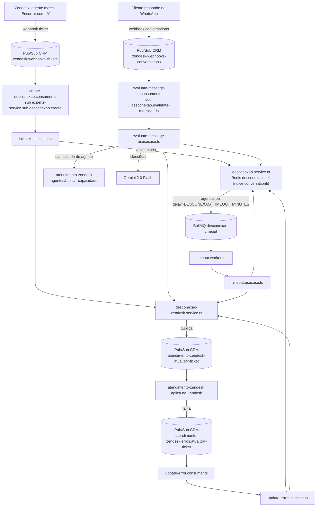

# Fluxo de Encerramento com IA (desconexão)

No código o fluxo se chama **desconexão** (`src/domain/desconexao` e `src/consumers/desconexao`). O agente marca o ticket de WhatsApp Experts com o status customizado **"Encerrar com IA"**; o serviço tira o ticket da fila do agente (grupo "Em espera", status "Aguardando confirmação de resolução") e espera o cliente. Se o cliente responder, a IA (Gemini) decide se ele está encerrando (resolve o ticket) ou quer continuar (devolve ao agente ou ao grupo). Se não responder até o timeout, o ticket é resolvido por inatividade.

Base dos links: `https://gitlab.com/ctbz/experts/backend/experts-service/-/blob/master/`. Diagramas de negócio e técnico antigos: `docs/desconexao/bpmn.drawio.png` e `docs/desconexao/bpmn-tech.excalidraw.png`. Diagrama visual completo (4 raias, nós clicáveis para o GitLab, tabelas de tempos e IDs) gerado em 2026-10-27: `docs/desconexao/encerramento-ia.pdf`, com fonte em `encerramento-ia.html` (Mermaid via CDN; para regerar o PDF: `google-chrome --headless=new --no-pdf-header-footer --virtual-time-budget=15000 --print-to-pdf=encerramento-ia.pdf file://$PWD/encerramento-ia.html`).

## Diagrama

## Estados (Redis, sem TTL)

`AGUARDANDO_CLIENTE` → `EM_ATENDIMENTO` (cliente quer continuar, agente reabriu ou falha no update) ou `RESOLVIDO` (IA viu encerramento ou timeout). `ERRO` após mais de 3 falhas de atualização. Chaves: `desconexao:<uuid>` (JSON com `history`, `timeoutId`, `failures`) e `conversationid-desconexaoid:<conversationId>`. A tabela Postgres `desconexao` (`src/schema/desconexao.ts`) existe mas não é usada pelo fluxo.

## 1. Início — `initialize.usecase.ts`

Disparado por todo webhook de ticket. Validações em ordem:

1. Lock Redis `desconexao_init_lock:<ticket>-<status>` (2 s) contra webhooks duplicados.
2. Ticket via `WhatsApp` e plano da organização contendo `expert` (senão ignora em silêncio).
3. Se já existe desconexão `AGUARDANDO_CLIENTE` e o ticket voltou para `open` fora do grupo Em espera → `EM_ATENDIMENTO` (agente reabriu; timeout cancelado).
4. Se existe desconexão e o ticket está `solved/closed` → apaga a desconexão do Redis e sai (limpeza).
5. Grupo Em espera → ignora (evita loop com o próprio update).
6. `custom_status` ≠ "Encerrar com IA" → ignora.

A partir daqui, falha devolve o ticket (`open`, mesmo agente/grupo) com nota interna `[Encerramento com IA]`:

7. Formulário ≠ "Experts WhatsApp" (dev: "Atendimento Whats Experts") → `InvalidForm`.
8. Flags do grupo (`atendimento-zendesk` `GET zendeskapps/encerramento-automatico/grupo-flags`): erro na API → `ApiError`; `tipoFluxo ≠ EXPERTS` ou `grupoHabilitadoEncerramento=false` → `GroupNotEnabled`.
9. Sem agente atribuído → `NoAssignee`.
10. Última mensagem da conversa (Firestore AIDA `zendesk_message`) é do cliente → `LastMessageFromUser`.
11. Sem `sunshineConversationId` → `NoConversationId` (checado depois do passo 10; sem conversationId o passo 10 tende a quebrar antes).

Passou tudo: cria/reaproveita a desconexão (se já havia uma não resolvida, mantém id, histórico e falhas e remove o timeout antigo), agenda o timeout e atualiza o ticket: `assignee_id=null`, grupo **Em espera**, status customizado **Aguardando confirmação de resolução**, tag `system:experts_desconexao`.

## 2. Resposta do cliente — `evaluate-message-ai.usecase.ts`

O consumer só segue com evento cuja mensagem tem `content`, `conversation.id` e `author.type == 'user'`. Depois:

1. Sem desconexão para a conversa → ignora. Status `EM_ATENDIMENTO` → ignora.
2. Consulta capacidade do agente (`atendimento-zendesk POST agentes/buscar-capacidade`, canal whatsapp): `offline` → indisponível (`AGENTE_OFFLINE`); `qntdLivreCapacidade=0` e e-mail fora de `DESCONEXAO_FREE_CAPACITY_EMAIL_LIST` → indisponível (`SEM_CAPACIDADE`). Erro na API propaga (mensagem não processada).
3. Mensagem não textual (arquivo, áudio, imagem) → devolve ao atendimento (`UnsupportedMessage`), sem IA.
4. IA: `gemini-2.0-flash-001`, prompt conservador (na dúvida, `continue: true`; saudação sozinha = continuar; agradecimento/despedida/"só isso" = encerrar). Resposta sem JSON válido → erro.
5. `continue: false` → ticket `solved` com o agente/grupo originais e nota com a mensagem do cliente; status `RESOLVIDO` e entrada apagada do Redis.
6. `continue: true` → `open` com nota interna; agente disponível → volta para ele no grupo original (`ReturnAgent`); indisponível → vai para o grupo sem agente (`ReturnGroup` com o motivo). Status `EM_ATENDIMENTO`, timeout cancelado.
7. Fora do horário: entre `DESCONEXAO_AFTER_HOURS_HOUR_START` (padrão 18) e 23:59 (America/Sao_Paulo), qualquer retorno ao atendimento vai para o grupo **Retorno Encerramento Após 18h** (`desconexao_after_hours`), sem agente, motivo `FORA_DE_HORARIO`. De 00:00 até o início do expediente conta como horário normal.

## 3. Timeout — `timeout.worker.ts` + `timeout.usecase.ts`

Job BullMQ na fila `desconexao-timeout` (concorrência 5) com `delay = DESCONEXAO_TIMEOUT_MINUTES` (padrão 2 min se o parâmetro faltar). Se a desconexão ainda estiver `AGUARDANDO_CLIENTE`, resolve o ticket (`solved`, agente/grupo originais, nota "encerrado automaticamente por inatividade") e marca `RESOLVIDO`. A entrada no Redis é apagada depois, quando o webhook do ticket `solved` passa pelo passo 4 do início.

## 4. Falha ao atualizar o ticket — `update-error.usecase.ts`

Todo update sai por `desconexao-zendesk.service.ts` → Pub/Sub `atendimento-zendesk-atualizar-ticket` com atributos `desconexao_id`, `ticket_id`, `conversation_id`, `source=desconexao-experts`. Se o atendimento-zendesk falhar, publica em `atendimento-zendesk.erros.atualizar-ticket`: o serviço soma uma falha; até 3 reabre o ticket ao agente/grupo (`open`, tag `system:experts_desconexao_error`) e vai para `EM_ATENDIMENTO`; na 4ª falha só marca `ERRO` (sem reabrir).

## Parâmetros e tempos (tabela `parameters`, cache Redis de 24 h)

| Parâmetro | Prod | Dev | Padrão no código |
| --- | --- | --- | --- |
| `DESCONEXAO_TIMEOUT_MINUTES` | 240 (4 h) | 1 | 2 |
| `DESCONEXAO_AFTER_HOURS_HOUR_START` | não cadastrado → 18 | 18 | 18 |
| `DESCONEXAO_FREE_CAPACITY_EMAIL_LIST` | 78 e-mails | 2 e-mails | vazio |

Valores consultados em 2026-10-27. Como `ParametersService` guarda o valor no Redis por 24 h, mudar o parâmetro no banco leva até 24 h para valer (ou apagar a chave `param:<chave>`). Outros tempos: lock de início 2 s; consumers Pub/Sub com `maxStreams: 1`; jobs BullMQ removidos ao concluir/falhar.

## IDs de configuração (`src/infra/config/{prod,dev}.ts`)

| Item | Prod | Dev |
| --- | --- | --- |
| Grupo Em espera | 17051057714844 | 17051000049564 |
| Grupo Retorno após 18h | 22590766510108 | 22590691689116 |
| Status "Aguardando confirmação de resolução" | 10273409877276 | 9368589333148 |

## Armadilhas

- O timeout só é reagendado/cancelado via `updateStatusByConversationId`; ir para `ERRO` agenda um novo job (que é ignorado) e a entrada `ERRO` fica no Redis para sempre (sem TTL).
- A disponibilidade do agente é consultada antes da IA mesmo quando o resultado será encerrar; se a API de capacidade cair, nenhuma resposta do cliente é avaliada.
- O prompt vai como primeira mensagem do chat, não como system instruction.
